# Telecom Customer Churn Analysis Using Random Forest

> An end-to-end machine learning project using Python and Random Forest to identify and segment customers at risk of churning and generate actionable business recommendations.

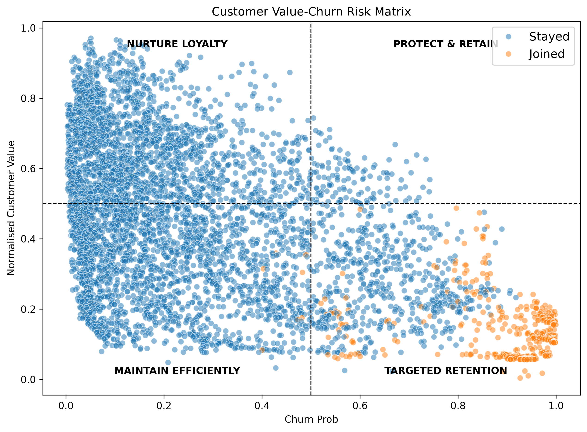

---

# Business Problem

I imagine myself as a data analyst at a telecommunications company that provides phone and internet services across California. The business has been losing subscribers and the retention team wants to know why, and how to retain them.

The retention team has limited time and budget, and wants to know:

- What characteristics most differentiate customers who leave from those who stay?
- Which of our current customers are most likely to churn?
- Of those, which are valuable enough to contact first?
- What should we actually do to keep them?

This project answers these questions in three steps:

1. Identify the characteristics that most differentiate churned customers from retained ones.
2. Build a prioritised list of at-risk, high-value customers for the team to contact proactively.
3. Provide data-backed recommendations on how best to retain them.

Because missing a customer who is about to leave costs far more than offering a retention incentive to someone who would have stayed, the model is optimised primarily for **recall** (catching as many churners as possible) while keeping precision reasonable.

---

# Dataset

This project uses the **Telecom Customer Churn** dataset from [Maven Analytics](https://mavenanalytics.io/data-playground/telecom-customer-churn), a fictional telecom company with **7,043 customers** in California at the end of Q2 2022. Download the data and data dictionary and place them in the `datasets/` folder.

The dataset has 38 columns, grouped as follows:

| Group | Columns |
|-------|---------|
| Basic customer information | Customer ID, Gender, Age, Married, Number of Dependents, City, Zip Code, Latitude, Longitude |
| Other key information | Number of Referrals, Tenure in Months, Offer |
| Phone services | Phone Service, Avg Monthly Long Distance Charges, Multiple Lines |
| Internet services | Internet Service, Internet Type, Avg Monthly GB Download |
| Value-added services | Online Security, Online Backup, Device Protection Plan, Premium Tech Support |
| Streaming services | Streaming TV, Streaming Movies, Streaming Music |
| Contract details | Unlimited Data, Contract, Paperless Billing, Payment Method, Monthly Charge |
| Revenue | Total Charges, Total Refunds, Total Extra Data Charges, Total Long Distance Charges, Total Revenue |
| Churn details | Churn Category, Churn Reason |
| **Target** | **Customer Status** |

The target, `Customer Status`, has three values:

- **Churned**: left during the observed period and is no longer a customer.
- **Stayed**: an existing customer who remained active.
- **Joined**: a new customer who joined during the period and remained active.

Joined customers are removed before modelling (they were not part of the starting customer base, so including them would distort churn rates), but they are scored by the final model later on.

---

# Project Workflow

```text
Load Dataset
      ↓
Assess Data & Handle Missing Values
      ↓
Outliers, Skewness & Correlation
      ↓
Remove Joined Customers & Check Target Imbalance
      ↓
Feature Engineering (Age & Tenure Segments, Encoding)
      ↓
Baseline Random Forest
      ↓
Improve the Model (Engineered Features, Downsampling, Tuning)
      ↓
Final Evaluation on Test Set
      ↓
Feature Importance & Churn Drivers
      ↓
Score Current Customers (Value vs Churn Risk Matrix)
      ↓
Prioritised Contact List & Recommendations
```

---

# EDA

## Part 1: Initial Setup

**Why:** Before cleaning or modelling, I needed to know what the data looks like and which columns are useful.

**What I did:** Wrote a reusable `dataset_check()` function to review shape, data types, missing values, duplicates, unique values and summary statistics, then split columns into numerical and categorical. I excluded `Zip Code`, `Latitude` and `Longitude` (location is not the focus of this project), `Customer ID` (not meaningful) and `City` (1,106 unique values).

**Result:** 7,043 rows and 38 columns, no duplicates, correct data types. 12 of 15 numerical columns and 21 of 23 categorical columns (including the target and the churn labels) are used. 15 columns contain missing values.

## Part 2: Handling Missing Data

**Why:** The missing values looked structural rather than random, so they needed to be understood before being filled.

**What I did:** Grouped the 15 columns with nulls and verified each hypothesis in code:

| Group | Columns | Why they are missing | Fix |
|-------|---------|----------------------|-----|
| 1 | Churn Reason, Churn Category | Customer did not churn (5,174 customers) | `Not Applicable` |
| 2 | Offer | Customer did not accept an offer | `None` |
| 3 | 10 internet-related columns | No internet service (1,526 customers) | `No`, `None` or `0.0` |
| 4 | Avg Monthly Long Distance Charges, Multiple Lines | No phone service (682 customers) | `0.0` or `No` |

I also confirmed that `Total Revenue = Total Charges - Total Refunds + Total Extra Data Charges + Total Long Distance Charges` holds for every row.

**Result:** Every group's null count matched the hypothesis exactly, so no rows were dropped and nothing was imputed with estimates. The dataset now has zero missing values.

## Part 3: Numerical Variables (Outliers and Skewness)

**Why:** Outliers and skewed distributions can affect model quality, so I wanted to know whether either needed treatment.

**What I did:** Checked outliers with the IQR rule and plotted each variable. For histograms, I chose bin counts using the Freedman-Diaconis rule (or Scott's rule for roughly symmetric variables) and classified skewness using standard rules of thumb.

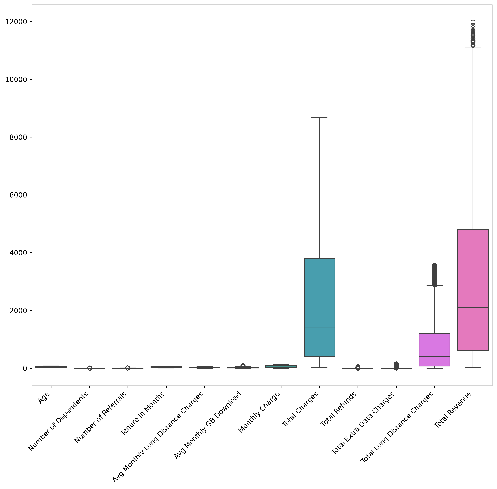

| Variable | Skewness | Classification | Histogram bin method |
|----------|---------:|----------------|----------------------|
| Total Refunds | 4.33 | Highly skewed | Default 10 bins (IQR = 0) |
| Total Extra Data Charges | 4.09 | Highly skewed | Default 10 bins (IQR = 0) |
| Number of Dependents | 2.11 | Highly skewed | Default 10 bins (IQR = 0) |
| Number of Referrals | 1.45 | Highly skewed | Freedman-Diaconis |
| Total Long Distance Charges | 1.24 | Highly skewed | Freedman-Diaconis |
| Avg Monthly GB Download | 1.22 | Highly skewed | Freedman-Diaconis |
| Total Charges | 0.96 | Moderately skewed | Freedman-Diaconis |
| Total Revenue | 0.92 | Moderately skewed | Freedman-Diaconis |
| Monthly Charge | -0.28 | Approximately symmetric | Scott's rule |
| Tenure in Months | 0.24 | Approximately symmetric | Scott's rule |
| Age | 0.16 | Approximately symmetric | Scott's rule |
| Avg Monthly Long Distance Charges | 0.05 | Approximately symmetric | Scott's rule |

Skewness thresholds: below -1 or above 1 is highly skewed, 0.5 to 1 (in absolute value) is moderately skewed, and below 0.5 is approximately symmetric.

**Result:**

- 7 variables contain outliers (on the full dataset): Number of Dependents (1,627), Total Extra Data Charges (728), Number of Referrals (676), Total Refunds (525), Avg Monthly GB Download (362), Total Long Distance Charges (196) and Total Revenue (21).
- They are rare but valid cases (for example, most customers have no refunds or extra data charges), so I **kept them**.
- 4 variables are approximately symmetric, 2 are moderately right-skewed and 6 are highly right-skewed.
- Tree-based models such as Random Forest are not affected by skewness, so **no transformations were applied**.


## Part 4: Categorical Variables and Target Imbalance

**Why:** Heavily imbalanced features carry little information, and an imbalanced target can bias a model towards the majority class.

**What I did:** Plotted category counts for every categorical feature, removed the 454 Joined customers (6.45%), and examined the remaining target distribution and the reasons customers gave for leaving.

**Result:**

- Phone Service, Internet Service, Online Security and Premium Tech Support are each dominated (over 70%) by a single value.
- 6,589 customers remain: **4,720 Stayed (71.6%)** and **1,869 Churned (28.4%)**. This target imbalance is handled later through downsampling.

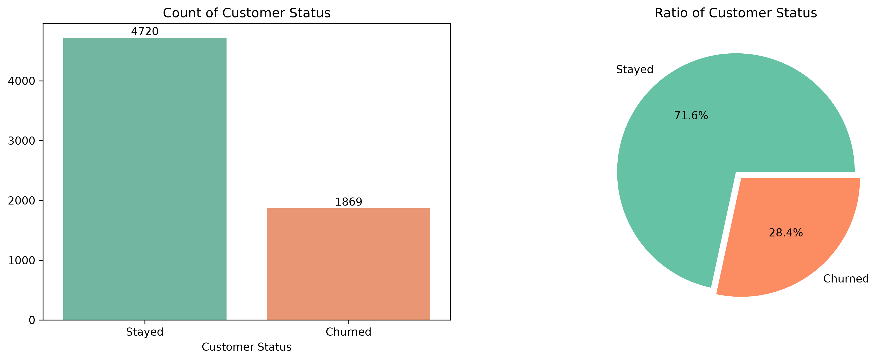

- Among churned customers, 45.0% left for a competitor, 17.2% due to dissatisfaction, 16.8% due to staff attitude, 11.3% due to price and 9.7% for other reasons. The top individual reasons were competitors with better devices, competitors with better offers, and the attitude of support staff.

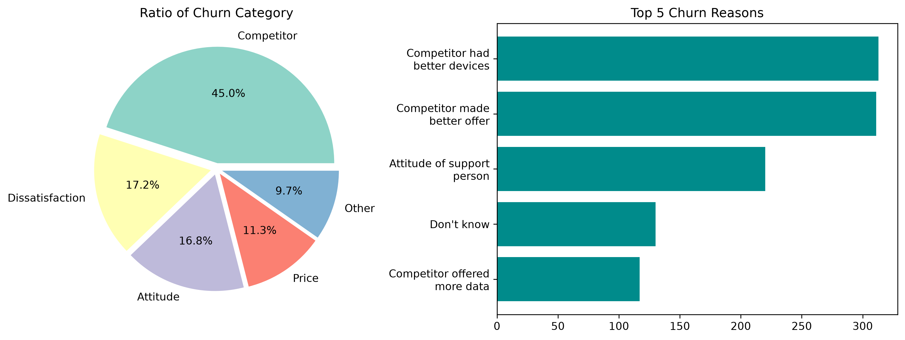

## Part 5: Correlation

**Why:** Redundant features can reduce classification accuracy, so I wanted to know where they exist.

**What I did:** Plotted a correlation matrix of the numerical variables and listed all pairs above 0.5.

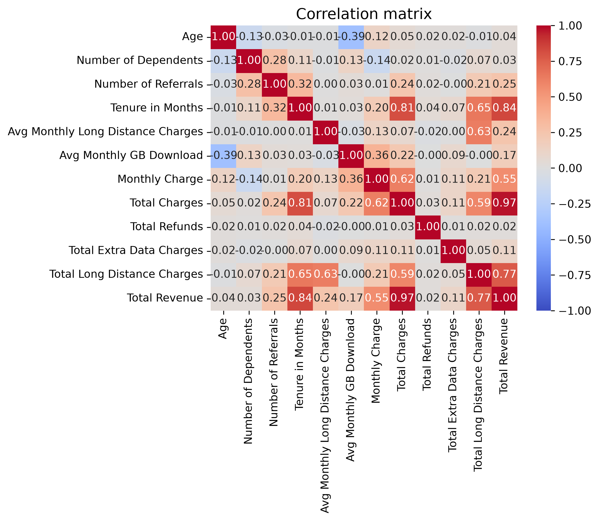

**Result:** The strongest correlations all involve the derived `Total Revenue` variable: Total Charges (0.97), Tenure in Months (0.84) and Total Long Distance Charges (0.77), plus Tenure and Total Charges (0.81). Random Forest is robust to multicollinearity, so I **kept all features**.

## Part 6: Feature Engineering (Tenure and Age Segments)

**Why:** Grouping customers by tenure and age can reveal churn patterns that raw numbers hide, and gives the model additional domain-based features.

**What I did:** Created a binary `Churn Binary` target, then segmented customers into five tenure groups (Newbie 0-6 months, Early bird 7-12, Established 13-24, Long-term 25-48, Loyalist >48) and five age groups (Youth 19-25, Young Adults 26-44, Middle Age 45-59, Elderly 60-74, Senior 75+).

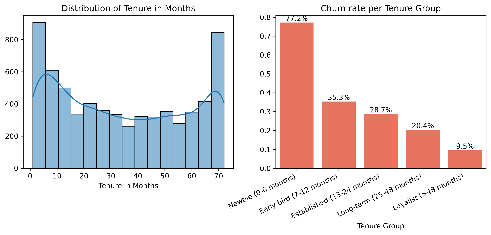

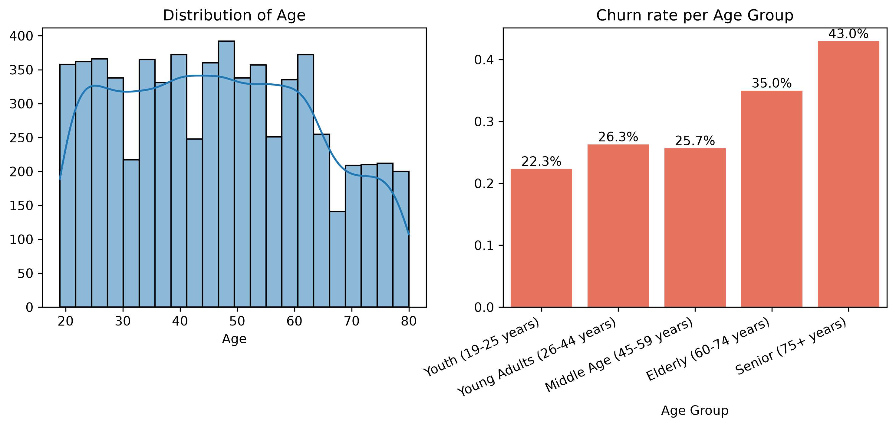

**Result:** Tenure is a strong signal. **77.2% of Newbies churn**, falling steadily to 9.5% for Loyalists. Churn also rises with age, from 22.3% for Youth to 43.0% for Seniors, though the age effect is smaller.

## Part 7: Categorical Encoding

**Why:** Random Forest in scikit-learn requires numerical inputs.

**What I did:** Binary-encoded two-value variables (Yes/No, Male/Female) and one-hot encoded `Offer`, `Internet Type`, `Contract`, `Payment Method`, `Age Group` and `Tenure Group`.

**Result:** The modelling dataset has **42 baseline features**, and 52 once the ten age and tenure group columns are added.

---

# Building the Model

**Why Random Forest:** It handles mixed feature types, is robust to outliers, skewness and correlated features, and provides feature importances that directly support the "which features matter" question.

**Choosing the metric:** A false negative (a churner predicted to stay) costs far more than a false positive (a customer who gets a retention offer but would have stayed). **Recall is therefore the primary metric**, with precision, F1, ROC-AUC and PR-AUC tracked alongside it so the model does not sacrifice precision entirely.

**What I did:**

- Split the data 80/20 with stratification (5,271 training and 1,318 test customers, `random_state=42`).
- Trained a baseline `RandomForestClassifier` with default settings and the 42 baseline features, evaluated with 5-fold cross-validation on the training set only.

**Baseline result (cross-validated):**

| Recall | Precision | F1 | ROC-AUC | PR-AUC |
|--------|-----------|----|---------|--------|
| 0.6876 | 0.8412 | 0.7562 | 0.93 | 0.87 |

The baseline is precise but misses around 31% of churners.

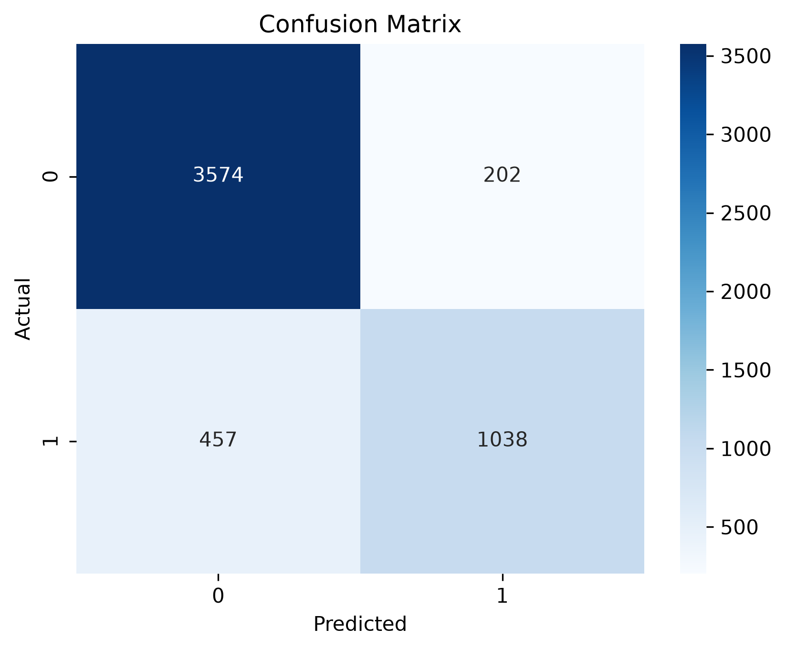

---

# Improving the Model

**Why:** The baseline's recall was too low for a retention use case, and the EDA had highlighted two things to act on: a target imbalance and informative tenure and age segments.

**What I did:**

1. **Engineered features:** added the ten age-group and tenure-group columns.
2. **Downsampling:** randomly undersampled the majority class (Stayed). This was done **inside** the cross-validation pipeline (using `imblearn`'s `Pipeline`) rather than before it, so validation folds are never resampled and no data leakage occurs.
3. **Hyperparameter tuning:** used `RandomizedSearchCV` (5 iterations, 5-fold CV, refit on F1) over `n_estimators`, `max_depth`, `min_samples_split`, `min_samples_leaf` and `max_features`.

**Result (cross-validated):**

| Metric | Baseline | Improved |
|--------|----------|----------|
| Recall | 0.6876 | **0.8301** |
| Precision | 0.8412 | 0.6911 |
| F1 | 0.7562 | 0.7540 |
| ROC-AUC | 0.9300 | 0.9256 |
| PR-AUC | 0.8700 | 0.8632 |

Recall rose by about 14 percentage points, at the cost of some precision. F1 and AUC scores are essentially unchanged, so this is a deliberate trade-off in favour of catching churners. The gap between training and validation scores is small across all metrics (at most 0.03), which suggests the model is neither badly overfitting nor underfitting.

| Baseline | Improved |
|:--------:|:--------:|
|  | 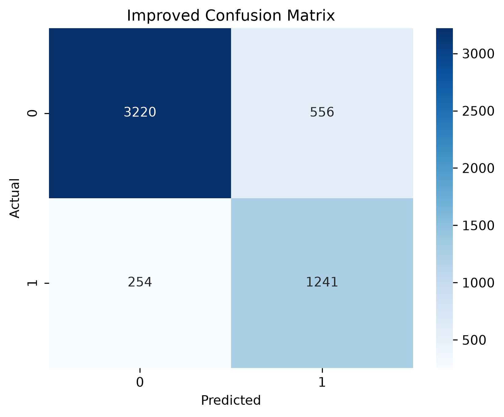 |

| ROC Curve Comparison | Precision-Recall Comparison |
|:--------------------:|:---------------------------:|
| 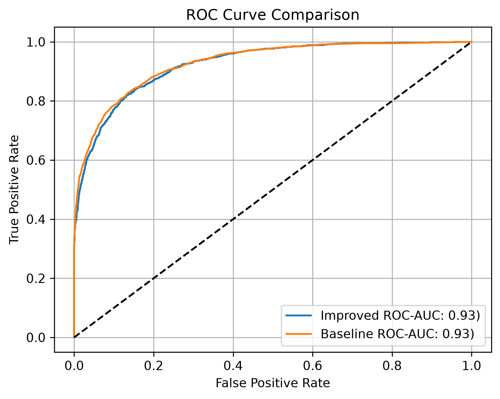 | 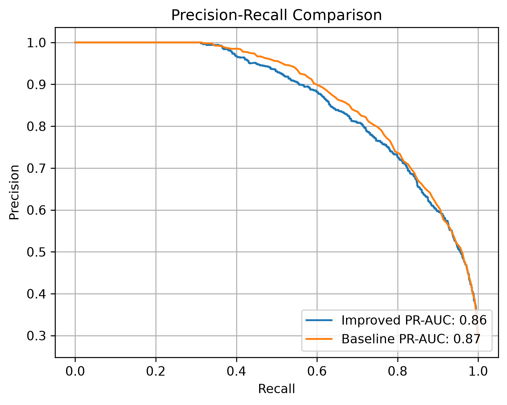 |

## Exploring Other Strategy Combinations (AI assisted)

To check whether a better combination existed, I built a pipeline framework that tests every valid permutation of engineered features, downsampling, upsampling, feature-importance selection (threshold 0.01) and Boruta selection (25 valid combinations), with all steps applied inside the cross-validation loop. Some of this code was developed with AI assistance (ChatGPT), which helped me catch a data leakage issue in my first approach. The conclusion was that the best combination was **not meaningfully better** than the model above, so I kept the simpler one.

Note: this portion is placed towards the end of the project, called `Additional: AI-assisted coding to find best valid combination`

---

# Results

## Final Test Set Performance

The tuned model was evaluated once on the untouched test set:

| Recall | Precision | F1 | ROC-AUC | PR-AUC |
|--------|-----------|----|---------|--------|
| 0.7968 | 0.6773 | 0.7322 | 0.92 | 0.85 |

Test scores are close to the cross-validated scores, indicating the model generalises well to unseen customers. It identifies roughly 8 in 10 churners.

## Which Features Distinguish Churners?

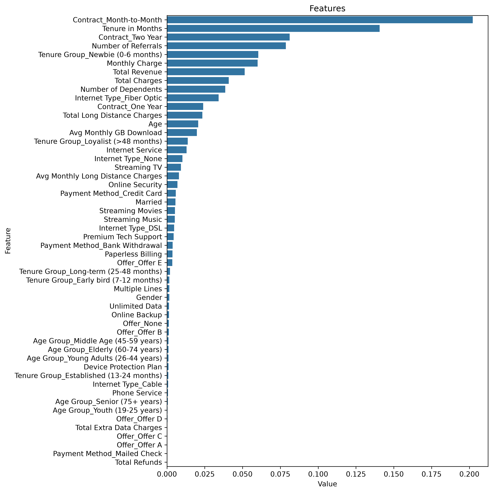

The most important features are contract type (month-to-month and two-year), tenure, number of referrals, the Newbie tenure group, monthly charge, total revenue and total charges, number of dependents and Fibre Optic internet.

## What Do These Features Tell Us About Customer Behaviour?

Feature importance says *which* features matter, not *how*. Comparing churn rates across them:

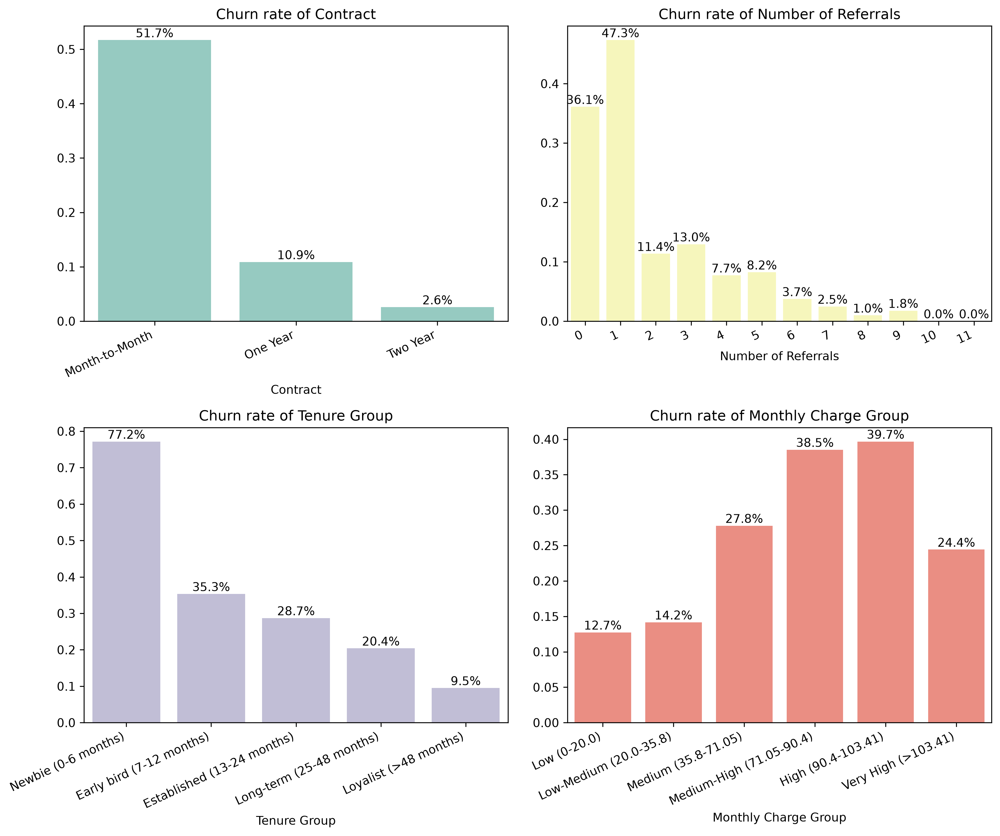

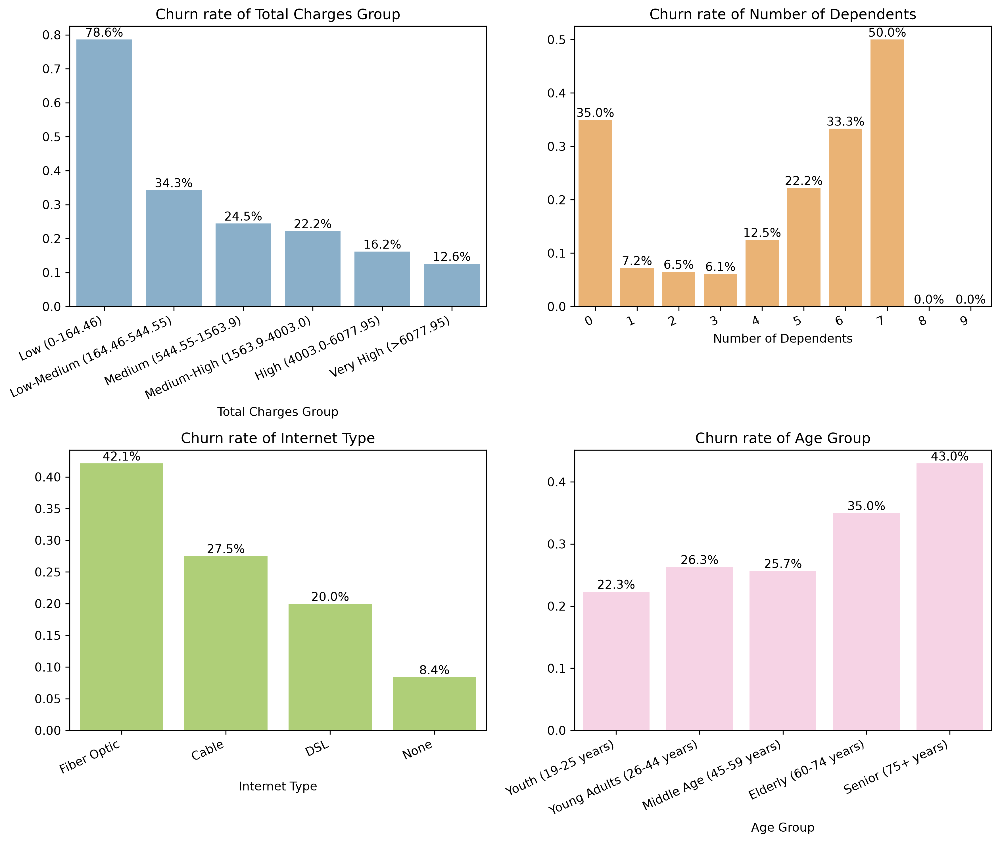

| Feature | What the data shows |
|---------|---------------------|
| **Contract** | Month-to-month customers churn at 51.7%, versus 10.9% for one-year and 2.6% for two-year contracts. Flexibility makes leaving easy. |
| **Tenure** | 77.2% of customers in their first 6 months churn, falling to 9.5% after 48 months. Early experience is critical. |
| **Number of referrals** | Customers with 2 or more referrals churn at 13% or less, while those with 0 or 1 churn at 36.1% and 47.3%. Referrals signal satisfaction. |
| **Monthly charge** | Churn peaks at 38.5-39.7% for customers paying roughly $71-$103 per month, versus 12.7% for the lowest-paying group. This may indicate customers at these price points feel competitors offer better value. |
| **Total charges** | The lowest group (a proxy for new customers) churns at 78.6%, falling to 12.6% for the highest. |
| **Number of dependents** | Churn is lowest at 1-3 dependents (about 6-7%), then climbs to 22.2% at 5, 33.3% at 6 and 50.0% at 7, although these larger households are small groups. Larger households may need more devices and faster internet. |
| **Internet type** | Fibre Optic customers churn at 42.1%, versus 27.5% for Cable, 20.0% for DSL and 8.4% for no internet. |
| **Age** | Churn rises from 22.3% (Youth) to 43.0% (Seniors). |

## Who Are the At-Risk Customers?

I used the final model to score every current customer (4,720 Stayed plus the 454 Joined customers who had been set aside), producing a churn probability for each.

I also created a **Normalised Customer Value** score from 0 to 1 that combines tenure (45%), number of referrals (30%) and monthly charge (25%), each min-max normalised. Plotting value against churn probability, and splitting both at 0.5, gives four segments:


| Segment | Value | Churn risk | Customers | Priority |
|---------|-------|------------|-----------|----------|
| **Protect and Retain** | High | High | 121 | Highest |
| **Targeted Retention** | Low | High | 1001 | High |
| **Maintain Efficiently** | Low | Low | 2,091 | Medium |
| **Nurture Loyalty** | High | Low | 1,961 | Low |

The full ranked list (sorted by customer value, then churn probability) is exported to `output/prioritized_list.csv` for the retention team.

---

# Recommendations

## By Segment

**Protect and Retain (121 customers, highest priority)**
These are long-tenured, high-value customers who are still at risk, often on month-to-month contracts or Fibre Optic internet.
- Offer incentives to move to a longer-term contract, bundled with superior products.
- Investigate Fibre Optic's competitiveness, value and customer experience.
- Review product mixes for larger households (5+ dependents) and plans in the $71-$103 range, where churn is highest.

**Targeted Retention (1001 customers, high priority)**
These are newer, lower-value customers with high churn risk, and most newly joined customers fall here. Because churners typically leave within the first 6 months, timing matters.
- Reduce friction during the first 6 months, when customers are still deciding whether the service meets expectations.
- Add proactive check-ins and feedback requests, and make customer support more responsive to early questions.

**Maintain Efficiently (2,091 customers, medium priority)**
Low risk and low value, but a chance to grow future high-value customers.
- Track churn risk and customer value over time as KPIs, and act promptly when risk rises or value falls.

**Nurture Loyalty (1,961 customers, low priority)**
The ideal customers, and the segment the business should aim to grow.
- Keep monitoring them and respond immediately to any increase in churn risk.

## Company-Wide

- **Compete on devices and offers.** 45% of churners left for a competitor, mainly citing better devices and better offers.
- **Invest in support quality.** Staff attitude is among the top reasons for leaving (16.8% of churners).
- **Do not chase referrals as a goal.** Referrals are a sign of satisfaction rather than a cause of retention, so the focus should stay on keeping customers satisfied.

---

# Summary

Using customer demographics, services and billing data, a tuned Random Forest model identified about 80% of churners on unseen customers (recall 0.80, ROC-AUC 0.92). The analysis showed that churn is concentrated among **new customers, month-to-month contracts, Fibre Optic users, mid-to-high monthly charges and older customers**, and that competitors, not price alone, are the main reason people leave.

Combining churn probability with a customer value score turned the model into a practical tool: a prioritised list of **125 high-value customers at high risk** that the team can contact first, with a further 997 early-tenure customers who need a better first six months.

**Limitations and next steps:**

- Hyperparameter tuning used only 5 random iterations, so more extensive tuning may help.
- The classification threshold was fixed at 0.5, and tuning it could further trade precision for recall.
- The customer value weights (45/30/25) are a judgement call and should be validated with the business.
- Only Random Forest was explored, so comparing with gradient boosting or logistic regression is a natural extension.

---

# Technologies Used

- Python
- Pandas
- NumPy
- Matplotlib
- Seaborn
- Scikit-learn
- Imbalanced-learn
- BorutaPy
- Jupyter Notebook

---

# Repository Structure

```text
telecom-churn-analysis/
│
├── datasets/
│   ├── telecom_customer_churn.csv
│   └── telecom_data_dictionary.csv
│
├── images/
│
├── output/
│   └── prioritized_list.csv
│
├── telecom-churn-analysis.ipynb
└── README.md
```

---

# How to Run the Project

Install the required packages:

```bash
pip install pandas numpy matplotlib seaborn scikit-learn imbalanced-learn boruta jupyter
```

Place the dataset files in `datasets/`, then run the notebook:

```bash
jupyter notebook telecom-churn-analysis.ipynb
```
